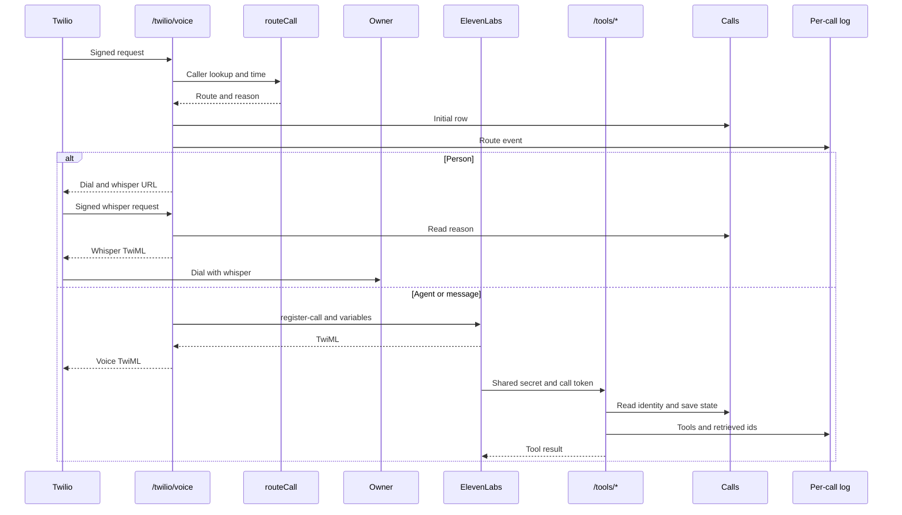

# Colos: phone agent and back office architecture

Architecture notes for the software behind Colos, a small shipping container brokerage my family ran. From 2021 to 2025 I was its general manager and its only engineer. As staff left and weren't replaced, I rebuilt their work in software: answering the phone, tracking inventory and supplier prices, handling price negotiation, and invoicing. By the end, the system covered roughly four people's work.

This repository documents the design, the trade-offs, and what broke. The original source code isn't included. The code here is a rebuild with synthetic data that shows how I'd build the same system today.

## System at a glance

- **Phone.** About 10 to 30 calls a day. A routing rule sent known customers to my phone during business hours. Every other call went to a voice agent on ElevenLabs' agent platform, with an OpenAI model writing the replies.
- **Data.** One shared Google Sheet held weekly inventory and prices, customer details, and notes. People edited it, my code read and wrote it through the Google Sheets API, and the agent read it. HubSpot was added later as the CRM.
- **Back office.** Node.js on Vercel. A cron job scraped supplier prices, and an OpenAI model handled the language work: checking price changes, negotiating, researching buyers, and suggesting suppliers.
- **Money.** Code enforced a price floor. Discounts and every invoice went through me. Wire invoices used the company's existing Excel template; card invoices went out through Stripe.

## Phone agent


**Routing.** Calls from saved numbers rang my phone from 8am to 6pm. Unknown numbers went to the agent at any hour, and from 6pm to 8am the agent took every call.

**The agent.** The agent ran on ElevenLabs' platform, on a Twilio number. ElevenLabs handled speech to text, turn-taking, and text to speech, and an OpenAI model wrote each reply. I configured the model with instructions and reference documents, and it read the shared sheet for inventory and customer notes.

**What worked.** Short, factual calls and emails: whether a container was ready for pickup at the depot, whether we had one in stock, and depots or suppliers confirming pickup times.

**What didn't.** Existing customers calling about a problem, like a late container or a wrong invoice. They were already upset, and the agent could explain but couldn't fix anything, so they got angrier and some complained. In the end I routed calls back to my phone.

**The lesson.** The routing rule knew who was calling and when, but not why. A customer with an open problem who called after 6pm, or from an unsaved number, still reached the agent. Today I'd look the caller up first and send anyone with an open order or problem to a person, with a summary on screen.

## Back office


**Prices.** Suppliers changed prices weekly, each on its own day, so a cron job scraped their sites on Monday and Tuesday. The model checked what changed, and code updated inventory and prices in the sheet.

**Deals.** Customers negotiated by email or phone, and the model handled the back and forth. An offer that left less than $50 over our buying cost got a hard no: the model judged it, and code checked the math. Any other discount needed my approval. The model also researched companies that placed orders and suggested which supplier should fill each one.

**Invoices.** I triggered or approved every invoice. Wire invoices used the company's existing Excel template, filled with the customer's details and the order's line items. Card invoices were created through the Stripe API.

## Design decisions

| Decision | What it bought | What it cost |
|---|---|---|
| ElevenLabs' agent platform instead of a custom voice pipeline | Listening, turn-taking, voice, and telephony in one place, run by one engineer | Less control over each stage, and no per-stage latency numbers on my side |
| Route on caller and time of day | Known customers reached a person during business hours, and every other call still got answered | The rule knew who and when, not why |
| One shared Google Sheet | Anyone could read and fix it, version history came free, and the API was simple | No schema or row locking, and nothing checked how old a price was |
| Model negotiates, code enforces the floor | Natural back and forth without a rule for every phrasing, and no discount below the floor | The floor is only as good as the cost data behind it |
| Human approval on every invoice | Nothing went out unseen | I was the bottleneck, and approval missed both invoice errors |
| Scheduled scraping, Monday and Tuesday | No manual price entry, with runs timed to supplier updates | Prices go stale between a supplier's change and the next run, and site changes break scrapers |

## What broke

1. **Upset callers.** Described above.
2. **Stale prices.** An invoice went out before that week's price update landed. It used last week's price, and we lost money on the order.
3. **A skipped discount.** Regular customers got a slightly lower price. One invoice skipped that step and went out at full price.

Both invoice errors passed my approval. Approval can't catch what the approver can't see. The checks belong in code, before a person reviews, and the review screen should show the numbers that tend to go wrong. The same weak spot sat under the $50 floor: it compared against our cost, and that cost was only as fresh as the last scrape.

## What I'd change today

- **Route on why.** Look the caller up before the agent speaks. Anyone with an open order or problem goes to a person, with a summary on screen.
- **A real source of truth.** Move the data into Postgres, put a date on every price, and keep a spreadsheet view for people.
- **Invoices built from rules.** Apply each customer's discount in code, refuse stale prices, and approve a preview that shows list price, discount, final price, and the price date.
- **Exactly-once billing.** Send every Stripe create with an idempotency key, and reconcile against Stripe nightly.
- **Measure the voice path.** Log end of turn, transcription, first token, and first audio on every call, and track p95 latency, transfers, callbacks, and complaints.
- **Evals.** Turn rejected drafts and complaint calls into a test set that runs before every prompt or model change.

## Reference implementation

The code below is a working reference built from the account above. All customers, orders, notes and supplier pages are synthetic. It is not the code that ran at Colos. The original diagrams describe the old system. The rebuild adds intent routing, isolated retrieval, rule-based invoices and evals.

### Setup

1. Install Node.js 22 and run `npm ci` from this directory.
2. Create a Google Cloud project and enable the Google Sheets API.
3. Create a service account and download its JSON key.
4. Create a blank Google Sheet.
5. Share the sheet with the service account email as an editor.
6. Copy `.env.example` to `.env`. Set `OPENAI_API_KEY`, `GOOGLE_SHEET_ID`, and `GOOGLE_SERVICE_ACCOUNT_JSON`. The JSON can be raw or base64. A key file path in `GOOGLE_APPLICATION_CREDENTIALS` can replace the JSON value.
7. Run `npm run doctor`. It checks model access, sheet access, headers and integration configuration. Missing tabs are expected before seeding. A permission error prints the email to share with.
8. Run `npm run seed`, then `npm run index`. Seed creates tabs with bold, frozen headers. It refuses populated tabs unless explicitly forced.
9. Run `npm run chat -- --from +15555550199 --at 2026-11-10T19:30:00Z`. Ask whether 20GP containers are available in D01. Tool calls and sources print as they happen. Type `/quit` to leave.

For a walkthrough without accounts, set `DATA_SOURCE=local` and add `--offline` to the CLI commands, such as `npm run index -- --offline`. This uses a deterministic text adapter and fake embeddings even when an API key is present. Local writes go to `.cache/local`; the CSVs stay unchanged. Tests and evals always use isolated local data, even when a sheet is configured.

Try saved customer `+15555550101`, customer with an open issue `+15555550102`, and depot `+15555550181`. Use `2026-11-10T19:30:00Z` for business hours and `2026-11-11T03:00:00Z` for after hours. Unknown callers can verify with order `O001` and company `Alder Wharf Works`. A timestamp without an offset is interpreted in `TIMEZONE`. Timestamps with `Z` are UTC.

The fixtures capture a fixed week. Price refresh preserves the captured date. After the next scheduled update, an invoice refuses the old snapshot. Use the recorded date for a repeatable review:

```sh
DATA_SOURCE=local npm run prices:refresh -- --at 2026-11-11T19:00:00Z
DATA_SOURCE=local npm run negotiate -- fixtures/emails/lowball.txt --at 2026-11-11T19:00:00Z
DATA_SOURCE=local npm run negotiate -- fixtures/emails/discount.txt --at 2026-11-11T19:00:00Z
DATA_SOURCE=local npm run invoice:preview -- O001 --at 2026-11-11T19:00:00Z
DATA_SOURCE=local npm run invoice:approve -- O001 --at 2026-11-11T19:00:00Z
DATA_SOURCE=local npm run invoice:send -- O001 --at 2026-11-11T19:00:00Z
```

Preview applies the active discount and binds approval to the reviewed facts. Send checks those facts again. Wire output goes to `out/`. Add `--method card` to each invoice command for Stripe test mode. Without a Stripe key, send reports a dry run and creates no Stripe invoice. Email drafts and callbacks stay in Outbox; no email sender is connected.

### Code and diagrams

| Diagram box | Implementation |
|---|---|
| Routing rule, owner phone | `src/domain/routing.ts`, `src/phone`, `src/server` |
| ElevenLabs agent, OpenAI model | `src/agents`, `prompts`, shared tools under `/tools/*` |
| Documents and customer notes | `src/rag`, added to the phone path |
| Google Sheet | `src/data`, row schemas in `src/domain` |
| Supplier websites and scraper | `fixtures/suppliers`, `src/backoffice/prices.ts` |
| Price review and negotiation models | `src/agents/price-reviewer.ts`, `src/agents/negotiator.ts` |
| Price rules and owner approval | `src/domain/pricing.ts`, `src/backoffice` |
| Wire and card invoices | `src/backoffice/invoices.ts`, `fixtures/invoices` |
| Shared configuration and local controls | `src/config`, `src/cli` |
| Measurement added to both diagrams | `evals`, unit tests, `.logs` |

`npm run dev` starts Hono. `/health` reports the last successful price run and its age. `/cron/prices` requires a bearer `CRON_SECRET`. `/tools/*` requires configured Twilio authentication, `x-tool-secret` and an expiring signed token bound to a recorded call. Missing secrets disable remote writes. Without a Twilio token, the voice webhook returns an inert dry run before reading an account. When configured, Twilio signatures are checked against the incoming URL. Configure Twilio with the exact public webhook URL.

The Vercel entry point is `api/index.ts`. Cron runs on Monday and Tuesday in UTC. `vercel.json` includes prompts and fixtures. On Vercel, temporary files go under `/tmp/colos`. Persist logs and generated invoices elsewhere before relying on a deployment.

### How it works

#### A call, end to end

[createApp](src/server/app.ts) checks the Twilio signature, then [createConversation](src/agents/phone.ts) looks up the caller before [routeCall](src/domain/routing.ts) chooses a route. The voice handler either dials the owner with a reason whisper or calls [ElevenLabsBridge.register](src/phone/elevenlabs.ts). The hosted agent calls the shared tools through HTTP. The CLI and evals use the local text agent instead. See [architecture](docs/architecture.md#call-entry-and-routing).



This shows the configured path. A message route also records a priority callback. Missing integrations take the dry-run branches described below.

| Caller type | Open issue | Business hours | Route |
|---|---|---|---|
| Saved depot or supplier | Any | Any | Agent |
| Saved customer | Yes | Yes | Owner with issue whisper |
| Saved customer | Yes | No | Agent takes message; priority callback |
| Saved customer | No | Yes | Owner |
| Saved customer | No | No | Agent |
| Unknown | Not yet known | Any | Agent; public facts until verification |

Business hours are 08:00 inclusive to 18:00 exclusive in TIMEZONE by default. There is no weekend calendar. An open order alone does not trigger handoff. A newly verified unknown caller with an open issue is handed off by code.

#### One agent turn

In [createConversation.turn](src/agents/phone.ts), code checks the current input, calls the intent agent, and invokes handoff for an existing order problem. Otherwise the phone agent runs with tools. After the model answers, code replaces action claims with tool outcomes, gives handoff precedence and checks currency again. It then updates Calls and appends the turn log. Model errors and SDK guardrail trips produce a fixed fallback. See [the ordered steps](docs/architecture.md#a-text-turn).

The eight tools come from [createTools](src/agents/tools.ts), with inputs in [toolInputs](src/domain/tool-contracts.ts). Every handler validates its result. After handoff, only handoff remains available. Calls state and logs are saved around tool use; the writes below are the handler's business effects.

| Tool | Who can use it | Code checks | Writes |
|---|---|---|---|
| verify_identity | Any caller before handoff | Matching order and company; cannot switch verified account; open issues trigger handoff | Identity state; callback if issue found |
| availability | Any caller before handoff | Available inventory and optional type/depot filters | None |
| pickup_status | Verified customer | Order belongs to that customer; readiness from order status | None |
| pricing | Any caller before handoff | Effective list; stocked supplier; latest fresh cost; margin floor | Allowed quote state |
| search | Any caller before handoff | Own notes only; current policy only | Local retrieval cache |
| handoff | Any caller | Marks handoff; selects business-hours message | Priority callback in Outbox |
| pickup_confirmation | Saved depot or supplier | Order assigned to that party | Alert in Outbox; no order change |
| negotiate_offer | Verified customer | Own order; fresh cost; code-owned offer decision | Discount Approvals; refresh may append prices and job records |

#### The money path

[priceFloor and decideOffer](src/domain/pricing.ts) enforce cost plus at least 5000 cents. Anything below that is hard_no. Any lower-than-list offer above the floor needs approval. The pricing tool checks effective dates, stocked suppliers and fresh costs before returning a list price. [allowedMoney](src/agents/guardrails.ts) allows only numeric currency returned by pricing in that conversation. It can reject harmless wording too.

[negotiate](src/backoffice/negotiation.ts) parses explicit email offer headers. Code owns the decision; [draftNegotiation](src/agents/negotiator.ts) only chooses permitted wording. [previewInvoice, approveInvoice and sendInvoice](src/backoffice/invoices.ts) recalculate facts, refresh or refuse stale costs, and bind approval to a SHA256 fingerprint. Stripe operations have separate idempotency keys derived from that fingerprint. Send persists the Stripe invoice id before adding items, then checks existing items on retry.

For O001, [verification](docs/verification.md) records list 280000 cents, discount 14000, final 266000, cost 202000 and margin 64000. The floor is 207000 cents, calculated as recorded cost 202000 plus the configured 5000 minimum. The 200000 offer is refused; 220000 needs approval. See [the invoice walkthrough and retry limits](docs/architecture.md#money-from-quote-to-invoice).

#### Retrieval

[RagIndex.buildIndex and search](src/rag/index.ts) split knowledge by heading and keep one chunk per note. `tokenize` lowercases ASCII words, removes fixed stop words and trims some plural endings. BM25 uses k1 = 1.2 and b = 0.75. Vector search uses text-embedding-3-small by default. `fuse` combines ranks with reciprocal rank fusion, k = 60, because BM25 and cosine scores have different scales.

Own-account and current-policy filters run before scoring. Rerank, when enabled for live search, reorders the top 20 fused chunks. The index reuses content hashes inside a model-keyed cache, validates vectors, writes a unique temporary file and atomically renames it. See [retrieval](docs/rag.md) for formulas, filter boundaries and cache behavior.

#### Failure modes

| What fails | What code does |
|---|---|
| Sheets 429 | withBackoff retries with exponential delay and jitter, then throws after exhaustion |
| Conflicting edit | Upsert throws ConflictError before writing; no automatic merge |
| Supplier layout | Parser rejects; refresh queues an alert and records failure |
| Stale cost | Public price tool refuses; invoice and negotiation pricing refresh, then refuse if still stale |
| Model error or guardrail | Text agent uses a fixed fallback; final action and money checks still run |
| Stripe midway | Retains saved invoice id and operation keys; retries inspect existing items and total |
| ElevenLabs unreachable | Registration times out or throws; Hono returns generic 500 without automatic transfer |
| Missing secret | Tool and cron endpoints return 401; unconfigured voice branches return dry-run TwiML |

See [failure behavior](docs/architecture.md#failure-behavior) for exact retry delays, partial-write behavior and the functions involved. Dry-run output is not proof of delivery.

#### Security model

Identity comes from a saved phone lookup or a matching order/company pair. [createTools](src/agents/tools.ts) enforces ownership and handoff state. [issueCallToken and verifyCallToken](src/phone/auth.ts) bind an expiring HMAC token to a saved call. HTTP tools require that token and the shared-secret header. [createApp](src/server/app.ts) validates Twilio signatures and keeps remote tool and cron routes disabled without secrets.

[unsafeInput](src/agents/guardrails.ts) catches selected call instructions and abuse. [suspiciousEmail](src/agents/negotiator.ts) skips model drafting for suspicious emails. Retrieved text is marked as untrusted in prompts, while code restricts access and writes. These are bounded checks. Caller ID is weak authentication, tokens can be reused before expiry, logs contain account data, and local output checks do not inspect hosted voice audio. See [security](docs/security.md).

#### Reading order

These ten files follow the request from entry to evidence. [Architecture](docs/architecture.md) explains the connecting steps.

1. [src/server/app.ts](src/server/app.ts): `createApp`, HTTP entry, authentication and tool state.
2. [src/domain/routing.ts](src/domain/routing.ts): `routeCall`, caller and time decisions.
3. [src/agents/phone.ts](src/agents/phone.ts): `createConversation`, turn loop and trace.
4. [src/agents/tools.ts](src/agents/tools.ts): `createTools`, access checks and side effects.
5. [src/domain/pricing.ts](src/domain/pricing.ts): `decideOffer`, discounts, floor and staleness.
6. [src/backoffice/invoices.ts](src/backoffice/invoices.ts): `currentPricing`, preview, approval and send.
7. [src/data/sheets.ts](src/data/sheets.ts): `SheetsDataSource`, conflicts, caching and backoff.
8. [src/rag/index.ts](src/rag/index.ts): `RagIndex`, embedding, filtering and ranking.
9. [src/agents/guardrails.ts](src/agents/guardrails.ts): `unsafeInput` and `allowedMoney`, including their limits.
10. [evals/run.ts](evals/run.ts): source-row checks, judge, thresholds and reports.

### Measured evals

These results are preserved in [live/full.json](evals/reports/live/full.json), generated on 2026-11-11 by `DATA_SOURCE=local npm run eval -- --repeat 2`. The live run used `gpt-5-mini`, `text-embedding-3-small` and the `gpt-5` judge. Both retrieval and behavior used the fixed labels and scenarios. No labels, thresholds or seed rows were changed to improve a score.

| Retrieval | Recall@1 | Recall@5 | MRR |
|---|---:|---:|---:|
| bm25 | 0.9250 | 0.9875 | 0.9750 |
| vector | 0.9500 | 1.0000 | 0.9875 |
| hybrid | 0.9500 | 0.9875 | 0.9875 |
| hybrid with LLM rerank | 0.9750 | 1.0000 | 1.0000 |

59 of 60 scenario runs passed (98.33%). Empirical pass^2 was 0.9667. There were 0 money failures.

Hybrid recall@5 exceeded the required 0.90. The report preserves the retrieval miss and the failed A26 repetition. Passing the suite does not establish accuracy outside these cases.

The offline comparison is preserved in [offline/full.json](evals/reports/offline/full.json), from `DATA_SOURCE=local npm run eval -- --offline --repeat 2`. It used the deterministic adapter and fake embeddings:

| Retrieval | Recall@1 | Recall@5 | MRR |
|---|---:|---:|---:|
| bm25 | 0.9250 | 0.9875 | 0.9750 |
| vector | 0.8625 | 0.9875 | 0.9333 |
| hybrid | 0.9000 | 0.9875 | 0.9625 |
| hybrid with LLM rerank | not run | not run | not run |

60 of 60 scenario runs passed (100.00%). Empirical pass^2 was 1.0000. There were 0 money failures.

Offline results do not establish live model accuracy. The live run exercised embeddings, model calls, the judge and the reranker. Cost and voice latency were not calculated. Actual scenario times and returned token usage are in the JSON reports. The reports state the limits of token accounting.

See the [live report](evals/reports/live/full.md), [live JSON](evals/reports/live/full.json), [offline report](evals/reports/offline/full.md) and [offline JSON](evals/reports/offline/full.json). The latest command also writes `evals/reports/latest.md` and JSON. `eval:retrieval` and `eval:agent` run the parts separately.

#### How grading works

[scenarioSchema and gradeCode](evals/grading.ts) define caller, time, turns and expectations. The real [A26 scenario](evals/scenarios/A26.json) asks whether an unpaid reservation lasts seven days and expects search to return K07. Code checks routing, tools, privacy and quoted amounts, then the harness recomputes facts from source rows. The live judge grades the transcript afterward. It cannot erase a code failure. See [the full example and grading order](docs/evals.md#scenario-format-and-grading).

The full-suite gates are hybrid recall@5 at least 0.90, scenario pass rate at least 0.90 and zero money failures. Both full reports carry test-set SHA256 `bb84b5d64b6994b80ed80a4a6d6e683ab80a54f0d44bd24cddb63163716c2e11`. It hashes raw retrieval labels plus sorted scenario texts, not code or prompts. Pass^k is the fraction of scenario ids passing every repetition. From live/full.json, 59/60 repetitions pass but only 29/30 ids pass both, giving pass^2 = 0.9667. Offline uses direct tool dispatch and fake embeddings; live uses the model loop and judge.

#### Reading the numbers

With 40 questions, a complete change on one question moves mean recall by `1 / 40 = 0.025`. Questions with multiple relevant ids get fractional credit, so smaller changes are possible. [run.ts](evals/run.ts) averages the fraction of relevant source ids found per query. It deduplicates heading chunks before grading.

Hybrid does not beat vector on this set. They tie on recall@1 and MRR, while vector recall@5 is 1.0000 against hybrid's 0.9875 in live/full.json. Hybrid stays because rank fusion is a small, inspectable way to combine literal terms and semantic matching. That is a design choice, not a measured gain. See [score interpretation](docs/evals.md#reading-retrieval-scores).

#### What happened in A26

The original local log matched the failed A26 repetition by exact turn timing and tool trace. It records `OutputGuardrailTripwireTriggered` after search returned current K07. The phone loop then emitted the owner-confirmation fallback. This was a reply check failure, not retrieval of the superseded rule.

The blocked draft was not logged, so its exact trigger wording is unknown. A read-only diagnostic shows that an answer containing both “seven days” and “supplier price” can fail `allowedMoney`: price activates money context and the spelled number is rejected. That is a possible false positive, not recovered model output. A future fix should distinguish durations from money and record the rejected draft safely. This pass leaves the guardrail unchanged. See [the evidence and diagnostic strings](docs/evals.md#a26-investigation).

#### Speed and tokens

Computed from [live/full.json](evals/reports/live/full.json), flattening transcript response.ms gives 66 turns: median 3.863 s, p95 5.905 s and max 6.420 s. The median uses the middle pair; p95 uses nearest rank; milliseconds are divided by 1000 and rounded to 3 decimals. These are text-path times on gpt-5-mini with low reasoning effort. They include deterministic responses and exclude judging. They are not voice latency.

Summing input and output for each of the report's 60 scenario repetitions gives median 2113.5 tokens, p95 4118 and max 4364. Judge tokens are separate. Grouping transcript toolCalls by name gives observed handler times, including nested work. [Evals](docs/evals.md#speed-and-tokens) includes the per-scenario token table, every tool's median, p95 and max, and the calculation script. No dollar cost or audio timing is inferred.

### Known limits

- Live OpenAI checks passed on local synthetic data. Google Sheets, Stripe, Twilio and ElevenLabs checks still need their credentials. See [verification](docs/verification.md) for the exact commands and skipped checks.
- A clean clone passed install, typecheck, lint, tests and build on Node.js 22. The recorded verification did not include remote CI or Vercel deployment.
- Sheets re-reads detect edits but cannot make the final read and write atomic. Local writes are serialized inside one process. Use a single billing worker until billing state and the outbox have durable transactions.
- Supplier pages are fixtures. Captured prices expire. The email offer parser requires explicit headers. Approved negotiations require an owner to update the pricing rule before invoicing.
- The ElevenLabs adapter follows its [register-call documentation](https://elevenlabs.io/docs/eleven-agents/api-reference/integrations/twilio/register-call), but has not been tested against a live account. The hosted voice agent still needs its prompts, tools, transfer behavior and output checks configured. Local text guardrails cannot intercept hosted audio.
- Phone handoff records a callback request and blocks further account tools. Initial known-customer routing can dial the owner with a whisper. Mid-call voice transfers need the hosted agent's transfer configuration.
- Currency guardrails use conservative text checks. They can refuse ambiguous wording. They supplement tool access and fixed evals; they do not prove arbitrary model language is safe.
- The wire template is synthetic, contains no bank details and labels its amounts in cents. Sending it prepares a file and queues a message. It does not deliver email. Vercel files are temporary.
- The tested defaults are `gpt-5-mini` for agent calls, `gpt-5` for grading and `text-embedding-3-small` for embeddings. Run evals before selecting another model.

See [decisions](docs/decisions.md) for scope choices and their costs.

## Stack

ElevenLabs agent platform, Twilio, OpenAI API, Node.js on Vercel, Google Sheets API, HubSpot, Stripe.

## Repository layout

```text
.
├── src/
│   ├── config/       # Environment parsing
│   ├── domain/       # Schemas and pure rules
│   ├── data/         # Local files and Sheets
│   ├── rag/          # Retrieval and embeddings
│   ├── agents/       # Tools, guardrails and model calls
│   ├── backoffice/   # Prices, deals and invoices
│   ├── phone/        # Voice bridge
│   ├── server/       # Hono routes
│   └── cli/          # Local commands
├── api/              # Vercel entry point
├── data/seed/        # Synthetic CSVs
├── fixtures/         # Supplier pages, emails and wire template
├── prompts/          # Shared system prompts
├── evals/            # Fixed tests and measured reports
├── test/             # Network blocking and credential isolation
├── docs/             # Decisions, verification and original diagrams
├── .github/workflows/
├── .env.example
├── package.json
├── AGENTS.md
├── README.md
└── LICENSE
```

The PNGs are what this README shows. The SVGs are the editable sources.

## Notes

Figures in the write-up are approximate and from memory. The code is a rebuild with synthetic data. It is not the code that ran at Colos.
