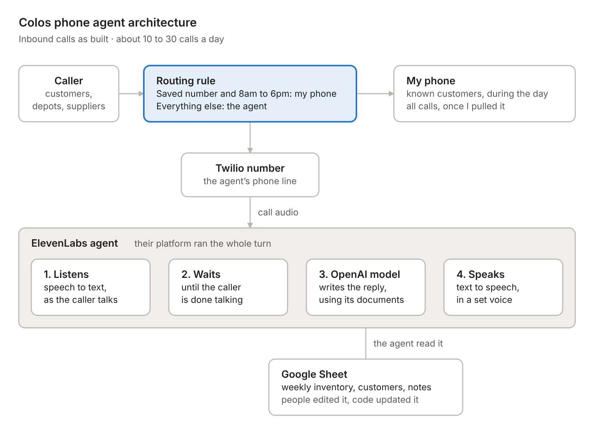
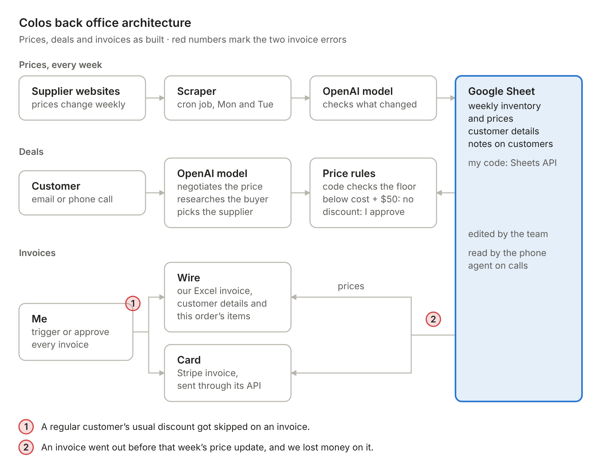

# Colos: phone agent and back office architecture

Architecture notes for the software behind Colos, a small shipping container brokerage my family ran. From 2021 to 2025 I was its general manager and its only engineer. As staff left and weren't replaced, I rebuilt their work in software: answering the phone, tracking inventory and supplier prices, handling price negotiation, and invoicing. By the end, the system covered roughly four people's work.

This repository documents the design, the trade-offs, and what broke. The original source code isn't included.

## System at a glance

- **Phone.** About 10 to 30 calls a day. A routing rule sent known customers to my phone during business hours. Every other call went to a voice agent on ElevenLabs' agent platform, with an OpenAI model writing the replies.
- **Data.** One shared Google Sheet held weekly inventory and prices, customer details, and notes. People edited it, my code read and wrote it through the Google Sheets API, and the agent read it. HubSpot was added later as the CRM.
- **Back office.** Node.js on Vercel. A cron job scraped supplier prices, and an OpenAI model handled the language work: checking price changes, negotiating, researching buyers, and suggesting suppliers.
- **Money.** Code enforced a price floor. Discounts and every invoice went through me. Wire invoices used the company's existing Excel template; card invoices went out through Stripe.

## Phone agent



**Routing.** Calls from saved numbers rang my phone from 8am to 6pm. Unknown numbers went to the agent at any hour, and from 6pm to 8am the agent took every call.

**The agent.** The agent ran on ElevenLabs' platform, on a Twilio number. ElevenLabs handled speech to text, turn-taking, and text to speech, and an OpenAI model wrote each reply. I configured the model with instructions and reference documents, and it read the shared sheet for inventory and customer notes.

**What worked.** Short, factual calls and emails: whether a container was ready for pickup at the depot, whether we had one in stock, and depots or suppliers confirming pickup times.

**What didn't.** Existing customers calling about a problem, like a late container or a wrong invoice. They were already upset, and the agent could explain but couldn't fix anything, so they got angrier and some complained. In the end I routed calls back to my phone.

**The lesson.** The routing rule knew who was calling and when, but not why. A customer with an open problem who called after 6pm, or from an unsaved number, still reached the agent. Today I'd look the caller up first and send anyone with an open order or problem to a person, with a summary on screen.

## Back office



**Prices.** Suppliers changed prices weekly, each on its own day, so a cron job scraped their sites on Monday and Tuesday. The model checked what changed, and code updated inventory and prices in the sheet.

**Deals.** Customers negotiated by email or phone, and the model handled the back and forth. An offer that left less than $50 over our buying cost got a hard no: the model judged it, and code checked the math. Any other discount needed my approval. The model also researched companies that placed orders and suggested which supplier should fill each one.

**Invoices.** I triggered or approved every invoice. Wire invoices used the company's existing Excel template, filled with the customer's details and the order's line items. Card invoices were created through the Stripe API.

## Design decisions

| Decision | What it bought | What it cost |
|---|---|---|
| ElevenLabs' agent platform instead of a custom voice pipeline | Listening, turn-taking, voice, and telephony in one place, run by one engineer | Less control over each stage, and no per-stage latency numbers on my side |
| Route on caller and time of day | Known customers reached a person during business hours, and every other call still got answered | The rule knew who and when, not why |
| One shared Google Sheet | Anyone could read and fix it, version history came free, and the API was simple | No schema or row locking, and nothing checked how old a price was |
| Model negotiates, code enforces the floor | Natural back and forth without a rule for every phrasing, and no discount below the floor | The floor is only as good as the cost data behind it |
| Human approval on every invoice | Nothing went out unseen | I was the bottleneck, and approval missed both invoice errors |
| Scheduled scraping, Monday and Tuesday | No manual price entry, with runs timed to supplier updates | Prices go stale between a supplier's change and the next run, and site changes break scrapers |

## What broke

1. **Upset callers.** Described above.
2. **Stale prices.** An invoice went out before that week's price update landed. It used last week's price, and we lost money on the order.
3. **A skipped discount.** Regular customers got a slightly lower price. One invoice skipped that step and went out at full price.

Both invoice errors passed my approval. Approval can't catch what the approver can't see. The checks belong in code, before a person reviews, and the review screen should show the numbers that tend to go wrong. The same weak spot sat under the $50 floor: it compared against our cost, and that cost was only as fresh as the last scrape.

## What I'd change today

- **Route on why.** Look the caller up before the agent speaks. Anyone with an open order or problem goes to a person, with a summary on screen.
- **A real source of truth.** Move the data into Postgres, put a date on every price, and keep a spreadsheet view for people.
- **Invoices built from rules.** Apply each customer's discount in code, refuse stale prices, and approve a preview that shows list price, discount, final price, and the price date.
- **Exactly-once billing.** Send every Stripe create with an idempotency key, and reconcile against Stripe nightly.
- **Measure the voice path.** Log end of turn, transcription, first token, and first audio on every call, and track p95 latency, transfers, callbacks, and complaints.
- **Evals.** Turn rejected drafts and complaint calls into a test set that runs before every prompt or model change.

## Stack

ElevenLabs agent platform, Twilio, OpenAI API, Node.js on Vercel, Google Sheets API, HubSpot, Stripe.

## Repository layout

```
.
├── README.md
├── LICENSE
└── docs/
    └── diagrams/
        ├── colos-phone-agent-architecture.png
        ├── colos-phone-agent-architecture.svg
        ├── colos-backoffice-architecture.png
        └── colos-backoffice-architecture.svg
```

The PNGs are what this README shows. The SVGs are the editable sources.

## Notes

Figures are approximate and from memory. This is a design write-up, not a working codebase.
