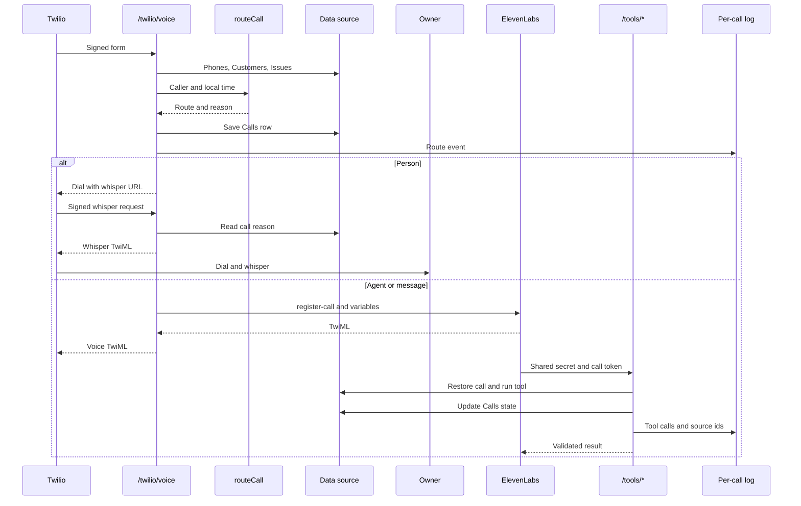

# Architecture

This describes the rebuild. The original phone and back-office diagrams remain historical. The text conversation and hosted voice integration share tools, but run different conversation loops.

## Call entry and routing

[createApp](../src/server/app.ts) installs the Twilio middleware before `/twilio/voice`. With a token configured, it validates the signature against the incoming URL and form parameters. Without a token it returns inert dry-run TwiML. It does not look up an account in that branch.

The voice handler validates From and To, then calls [createConversation](../src/agents/phone.ts). That function batches Phones, Customers and Issues. [routeCall](../src/domain/routing.ts) chooses the initial route before any agent reply. Depot and supplier routes take precedence. Open means `Issues.status === "open"`. An order alone does not cause a transfer.

| Caller | Open issue | Business hours | Route |
|---|---|---|---|
| Saved depot or supplier | Any | Any | Agent |
| Saved customer | Yes | Yes | Person, with issue summary |
| Saved customer | Yes | No | Message and priority callback |
| Saved customer | No | Yes | Person |
| Saved customer | No | No | Agent |
| Unknown number | Not yet known | Any | Agent; public information until verification |

Business hours default to 08:00 inclusive through 18:00 exclusive in America/Los_Angeles. `isBusinessHours` checks local time every day. It has no weekend or holiday calendar. [parseCallTime](../src/domain/time.ts) interprets bare CLI timestamps in TIMEZONE. Stored timestamps are UTC.

The person route emits TwiML Dial to OWNER_PHONE. Its Number callback points to `/twilio/whisper`, which reads the saved Calls reason and speaks it to the owner. Issue summaries are collapsed to one line and capped at 240 characters by `routeCall`. If OWNER_PHONE is absent, the handler records a callback and returns a transfer dry run.

The agent route calls [ElevenLabsBridge.register](../src/phone/elevenlabs.ts). It posts agent id, inbound numbers and dynamic variables to the Twilio register-call endpoint. Variables include caller name, company, open items, call id and call token. The response must contain TwiML. The bridge accepts raw XML or a JSON string containing XML. This boundary has mock tests but no live account verification.

The diagram assumes the relevant credentials are configured. After-hours issue routing queues the callback before voice registration. Mid-call `handoff` queues a callback; it does not emit a new Dial. Hosted transfer behavior must be configured in ElevenLabs.

## A text turn

[createConversation](../src/agents/phone.ts) loads the same [phone](../prompts/phone.md) and [intent](../prompts/intent.md) prompts used by evals. The loop is:

1. Clear the request cache and reset this turn's tool and retrieval trace.
2. Run `unsafeInput`. A matching abuse or instruction pattern gets a fixed refusal. A person route gets a fixed owner response.
3. Otherwise classify the current message into the fixed reason enum. Live classification is an SDK Agent call with structured output. Offline classification uses `offlineIntent` patterns.
4. For a message route or `existing_order_problem`, invoke `handoff` directly.
5. Otherwise run the phone Agent with SDK tools and input and output guardrails. The live phone run allows up to 10 SDK turns. The offline adapter dispatches directly to tools.
6. Catch a model error or SDK guardrail trip and use the owner-confirmation fallback. Log the error class.
7. Replace a negotiation or pickup-confirmation draft with the last action tool's message, including failed actions. A handoff message takes precedence.
8. Apply `allowedMoney` again to the final text. On failure use the fixed pricing-lookup reply.
9. Store history, update Calls and append the JSONL turn record. `measuredTurn` adds nested API usage and appends a separate `turn_usage` event.

The intent call allows up to 2 SDK turns. Both intent and phone use low reasoning effort when the configured model name starts with `gpt-5`. The initial route is deterministic. The intent model can discover a problem after initial routing but cannot grant account access.

Calls stores route, reason, the last reply truncated to 500 characters, outcome and `state_json`. State contains verified customer id and allowed currency amounts. The JSONL file under RUNTIME_DIR/.logs uses the generated call id. Route events, errors, tool calls, retrieved ids and elapsed times support tracing. Log timestamps use the conversation's supplied start time; they are not independent wall-clock timestamps for each text turn.

## Shared tools

[createTools](../src/agents/tools.ts) builds the SDK tools and the direct `invoke` entry point used by HTTP. [toolInputs](../src/domain/tool-contracts.ts) validates inputs; `toolResultSchema` validates outputs. SDK visibility is convenient, but handlers also enforce ownership. Direct invocation catches errors and returns a generic failed result with a logged error class.

The tool table in the [README](../README.md#one-agent-turn) lists all permissions and writes. Public search cannot request another customer id or include superseded policy. A handoff blocks every tool except handoff. Unknown identity verification checks the order and company together. If verification discovers an open issue, it invokes handoff immediately.

`pickup_status` reads Orders and Inventory, but readiness is derived from `Orders.status === "ready"`. It does not join a specific container's ready_for_pickup_at into the answer. `pickup_confirmation` records an alert; it never changes Orders or promises a booking.

## Money from quote to invoice

[priceFloor, decideOffer and invoiceMath](../src/domain/pricing.ts) accept integer cents. The floor is cost plus FLOOR_MARGIN_CENTS, whose minimum and default are 5000. An offer below the floor is hard_no. An offer at or above the floor but below list needs approval. At or above list it is accept. Invoice approval is still required.

The public `pricing` handler selects the latest effective list row. It considers only suppliers with available matching inventory, selects each supplier's latest nonfuture observation, rejects stale observations and chooses the cheapest remaining cost. It refuses a missing price or a list price below that cost plus the floor. It does not refresh prices or apply private customer discounts. A successful result adds only list_cents to the conversation's allowed amount set.

[allowedMoney](../src/agents/guardrails.ts) checks explicit numeric currency against that set. It normalizes Unicode and rejects malformed numbers and ambiguous bare prices. It also treats price-related wording as money context. This is conservative text matching, with known false positives described in [A26](evals.md#a26-investigation). An allowed quote remains allowed for the conversation; there is no per-quote expiry in the set.

[parseOfferEmail and negotiate](../src/backoffice/negotiation.ts) require exactly one Order header and one Offer or Offer-Cents header. Code parses the amount and calls `currentPricing` and `decideOffer`. [draftNegotiation](../src/agents/negotiator.ts) can select only one of the code-approved sentences for that decision. Suspicious emails skip the model. Invalid model output uses a fixed draft. Outbox receives a draft and discounts create Approvals. Approval does not itself install a PricingRules row.

### Worked invoice

The values below are the O001 command results recorded in [verification](verification.md). They use the captured fixture week, not a current supplier quote.

| Input or result | Cents |
|---|---:|
| List | 280000 |
| Active discount | 14000 |
| Final unit price | 266000 |
| Supplier cost | 202000 |
| Margin | 64000 |
| Floor | 207000 |

`280000 - 14000 = 266000`; `266000 - 202000 = 64000`; `202000 + 5000 = 207000`. These are arithmetic on the recorded verification values. The low email offer of 200000 is below the floor. The offer of 220000 clears the floor but needs discount approval.

[currentPricing](../src/backoffice/invoices.ts) uses the order's supplier, depot and type. Unlike public pricing, it refreshes that supplier if the cost is absent or stale. `isPriceStale` checks whether the supplier's scheduled weekly update passed after the last observation in TIMEZONE. Invalid or future observations are stale. Prices more than 8 days old are stale without further calendar scanning. A refresh must succeed and yield a fresh observation or the operation refuses.

`invoiceMath` selects the largest active discount without stacking. Percent arithmetic uses BigInt and rounds down to cents. Rule dates use the local calendar date. The order's historical agreed_unit_cents does not override current rules. The final amount must clear the floor.

### Preview, approval and send

[calculate](../src/backoffice/invoices.ts) hashes JSON containing order id, customer fields, supplier, depot, type, all computed amounts, quantity, source price date and reference, and payment method. The SHA256 fingerprint binds the review to those facts.

`previewInvoice` reuses a matching nonvoid version or writes a new Invoices row and pending Approvals row. `approveInvoice` recalculates, checks the row and fingerprint, then marks the approval and invoice approved. `sendInvoice` recalculates again. A changed input requires another preview and approval.

For cards, only Stripe test keys are accepted. Idempotency keys use `colos-<fingerprint>` with separate customer, invoice, item, finalize and send suffixes. The Stripe invoice id is persisted before item creation. A retry retrieves that invoice, checks its identity, items, currency and total, and continues from its state. A partial send can still require reconciliation. There is no distributed transaction or nightly reconciliation worker here.

For wire, `writeWire` fills the synthetic workbook and writes to out/. After output, send queues a stable SEND message before marking the invoice sent. Wire email remains pending. The sent status means file preparation completed, not email delivery. A missing Stripe key returns dry run without marking sent. Per-source send serialization is local to the DataSource instance; Sheets billing still needs a single worker.

## Failure behavior

| Failure | Implemented response |
|---|---|
| Sheets 429 | `withBackoff` retries up to 5 times after the first attempt. Delays are 1000, 2000, 4000, 8000 and 16000 ms plus 0 through 199 ms of jitter. Exhaustion throws. |
| Conflicting row edit | Fresh row comparison throws ConflictError before the write. No automatic merge. A race after the final comparison remains possible. |
| Supplier layout change | `parseSupplierPage` rejects missing table, wrong headers or malformed rows. `refreshPrices` queues an alert, records a failed supplier result and finishes JobRuns as failed if recording succeeds. |
| Odd supplier change | Deterministic changes over 20 percent or a model flag create a pending price-change approval. That supplier is not appended. |
| Partial supplier append | Prior appends remain. The failed result records their count. There is no rollback. |
| Stale price | Public pricing refuses. Invoice or negotiation pricing refreshes the supplier, then refuses if refresh fails or its observation remains stale. |
| Model error or guardrail trip | Phone catches it and uses the fixed owner-confirmation reply. Final action and money checks still run. Negotiation drafting uses a fixed fallback. Price-review errors fail that refresh. |
| Stripe fails midway | Exception propagates. Saved invoice id and operation keys support retry. Existing Stripe items and totals are checked. Local sent state is written only after the external steps and outbox write. |
| ElevenLabs unreachable | Fetch has a 15000 ms timeout. Non-success HTTP or missing TwiML throws. Hono returns generic HTTP 500; there is no automatic owner transfer or callback for a bridge failure. |
| Missing Twilio token | Inert TwiML dry run before caller lookup. |
| Missing tool or cron secret | Tool or cron endpoint returns 401. Missing tool secret on voice entry produces dry-run speech instead of bridge registration. |
| Missing owner or voice credentials | Missing owner records a callback. Missing ElevenLabs key or agent id returns voice dry-run TwiML. |

The retry numbers above are derived directly from `withBackoff` in [sheets.ts](../src/data/sheets.ts). All HTTP errors use `createApp`'s generic response: validation errors are 400 and other uncaught errors are 500. Tool `invoke` usually turns handler exceptions into a failed tool result instead.

## Data and deployment boundaries

[DataSource](../src/data/interface.ts) is the shared read and write contract. Sheets batches ranges, validates headers and rows, and uses RAW values. SupplierPrices is append-only. Upserts require an expected old row when replacing data. [RequestDataSource](../src/data/sheets.ts) caches within a request, invalidates writes and clears at text-turn boundaries.

[LocalDataSource](../src/data/local.ts) reads the same CSVs and stores changes separately. It serializes writes per directory in one process and uses temporary files plus rename. It has no cross-process lock. [seed](../src/data/seed.ts) validates all inputs before changing tabs and refuses populated tabs unless forced.

The [Vercel entry](../api/index.ts) uses temporary runtime storage. [vercel.json](../vercel.json) schedules Monday and Tuesday price jobs in UTC. Logs, indexes and generated invoices need durable storage for production. See [security](security.md), [retrieval](rag.md) and [evals](evals.md) for their separate limits.
