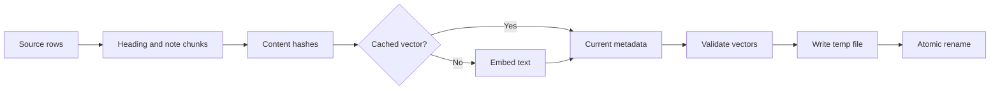

# Retrieval

All retrieval code lives in [src/rag/index.ts](../src/rag/index.ts). `RagIndex` implements `Retriever`; `FakeEmbedder` and `OpenAIEmbedder` implement `Embedder`. Live facts use tools instead. Retrieval cannot establish a current price, stock count or account status.

## Chunks and tokens

`buildIndex` batch-reads Knowledge and Notes. Knowledge splits before Markdown headings of levels 1 through 6. Each nonempty section is prefixed with its document title. Chunk ids use the source id and section index. Each note is a single chunk with its customer_id and created_at. There is no fixed token window, overlap or maximum chunk size.

`tokenize` lowercases ASCII letters and digits, splits with `[a-z0-9]+`, drops the fixed stop-word set and removes a trailing s from words longer than 4 characters. It does not use a language stemmer or OpenAI's tokenization. This tokenizer feeds BM25 and the fake embedder. OpenAI embeddings receive the original chunk or query text.

The live default is text-embedding-3-small. `OpenAIEmbedder.embed` sends batches of at most 64 texts and preserves response order by index. The fake embedder hashes tokens into a normalized bag of words with 2048 dimensions. Its deterministic tests do not measure semantic quality.

## Filters and rankings

`RagIndex.search` first excludes notes whose customer_id differs from the supplied verified account. Without an account it excludes all customer notes. It also excludes superseded documents unless include_superseded is explicitly enabled. These filters run before BM25 statistics, vector scoring, fusion and reranking. A note mentioning another company remains owned by its customer_id, not by names inside the text.

The public phone `search` tool in [createTools](../src/agents/tools.ts) supplies customer_id from conversation state. Its input contains only query. It does not expose include_superseded. Internal retrieval evals can request superseded text explicitly. This distinction lets the test set exercise the trap without giving callers a filter override.

`bm25` computes document frequencies on the filtered chunks. Query tokens are deduplicated. The formula uses k1 = 1.2 and b = 0.75, expressed as the 2.2 numerator and 0.25/0.75 length terms. Inverse document frequency is `log(1 + (N - df + 0.5) / (df + 0.5))`. Zero-match chunks remain in the ranking. Equal scores sort by chunk id.

Vector mode ranks cosine similarity to the embedded query. Hybrid mode calls `fuse` on both full rankings. A chunk receives `1 / (60 + rank)` from each ranking, with rank starting at 1. Thus reciprocal rank fusion uses k = 60. Equal fused scores also sort by chunk id.

Fusion uses ranks because BM25 scores and cosine similarities have different scales. It avoids choosing a conversion between them. The cost is losing the magnitude of each method's confidence. On the current set it does not beat vector. See the measured comparison in [evals](evals.md#reading-retrieval-scores).

## Reranking

The default search mode is hybrid with a limit of 5. The phone tool enables rerank only when RAG_RERANK is true and the run is live. The full live retrieval eval explicitly measures rerank regardless of that application flag. Offline retrieval reports it as not run.

`llmReranker` loads [reranker.md](../prompts/reranker.md), sends the query and top 20 fused chunks to an SDK Agent, and asks for ordered ids. It uses OPENAI_MODEL, with low reasoning effort for gpt-5 models. It reorders only the supplied candidates. Unknown ids cannot add a result; omitted ids sort after listed candidates. There is no catch that falls back to hybrid on a reranker error. A phone search error becomes a failed tool result.

Results return chunk id, source_id, updated_at, text, status, optional customer_id and score. After reranking, score remains the earlier fusion score; it is not a calibrated reranker score. The caller receives the requested prefix of results. Retrieval evals deduplicate section hits into source ids before grading.

## Incremental index

The cache directory defaults to .cache/rag. Its JSON filename is the first 16 hex characters of the SHA256 of the embedder name. Each chunk has its own SHA256 content hash. A build reuses vectors by content hash, embeds only missing unique text and refreshes all metadata from source rows. The filename is model-keyed; content hashes control reuse inside it. Model revisions under an unchanged name do not invalidate this cache.

Concurrent builds on the same index instance share the pending build promise. Missing or invalid cached JSON rebuilds from source. Vectors must be finite, nonempty, dimensionally consistent and match the expected response count. A unique temporary file is created exclusively, then renamed over the cache. Cleanup removes the temporary file. Rename avoids readers seeing a partial JSON write; it is not a cross-process source transaction.

The phone tool creates and builds an index for each search, so row metadata is checked again while vectors can be reused. Filters protect returned results and model reranker inputs. They do not partition the on-disk index: it contains all notes. Protect the runtime directory as sensitive account data. See [security](security.md).
